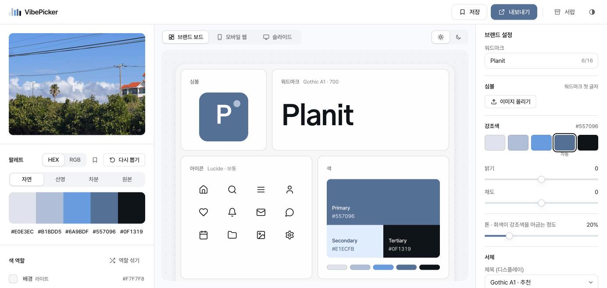
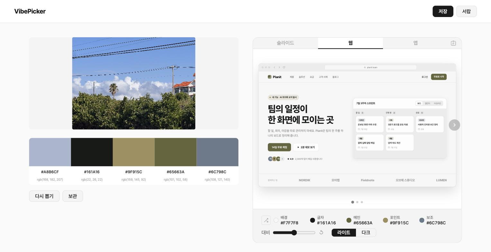
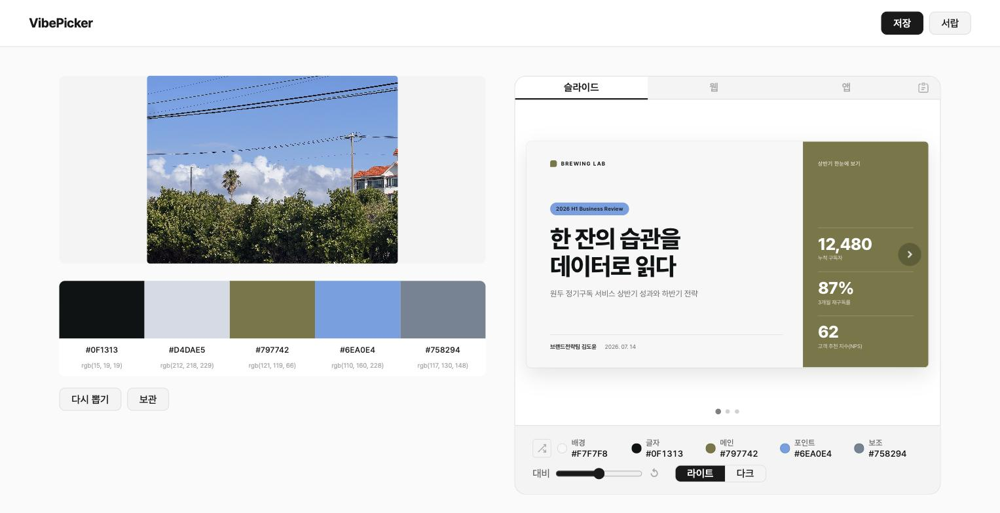
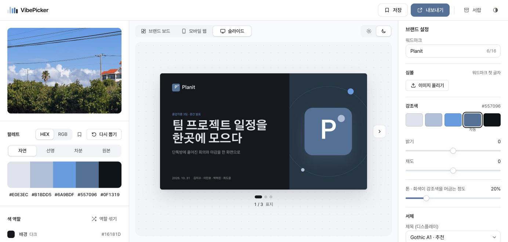
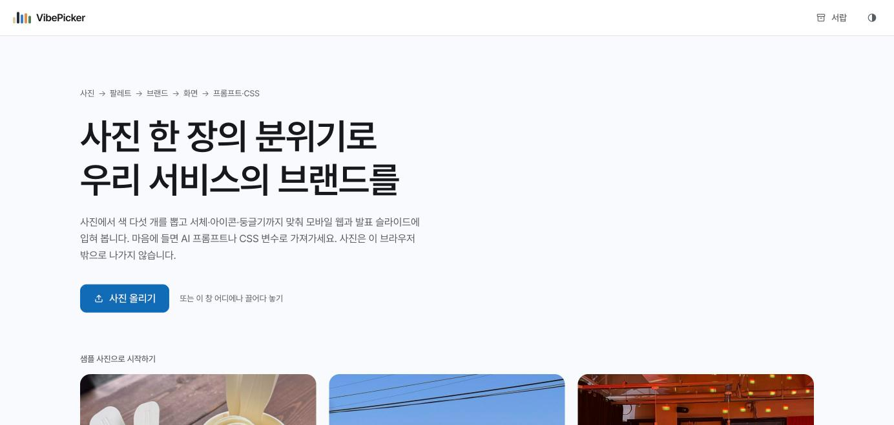
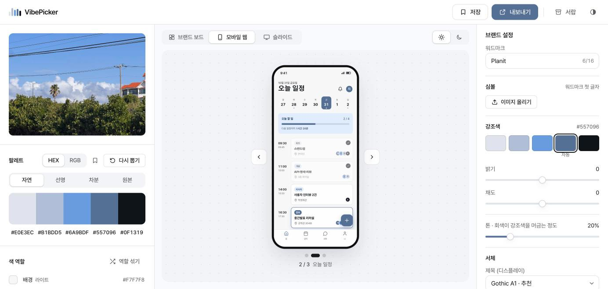

# VibePicker

> 사진 한 장의 분위기로 서비스의 브랜드(색·서체·아이콘·둥글기)를 정하고 그 브랜드를 모바일 웹과 발표 슬라이드에 입혀 본 뒤, AI 프롬프트와 CSS로 가져가는 웹앱

**바로 써 보기: https://hwangyerin.github.io/vibe-picker/**



중간고사 과제로, 실습 때 만든 VibePicker(v1)를 이어서 발전시킨 v2입니다. 실습 제출 시점의 코드는 [`v1-practice` 태그](https://github.com/Hwangyerin/vibe-picker/tree/v1-practice)에, 그때의 README·PRD·Todo는 [`docs/before/`](./docs/before/)에 그대로 남겨 두었습니다.

---

## 1. 제작한 것 소개

### 실습(v1)에서 만든 것

사진을 올리면 대표색 5개를 뽑고 그 색을 발표 슬라이드·웹사이트·앱 목업에 입혀 보여 준 뒤, 색 역할을 담은 AI 프롬프트를 복사하는 웹앱이었습니다. "AI가 만든 화면의 AI 티를 색부터 줄여 보자"가 출발점이었습니다.

### 왜 다시 만들었나

v1을 다 만들고 써 보니 세 가지가 남았습니다.

1. **색만으로는 AI 티가 사라지지 않았습니다.** 색을 정해 줘도 AI는 늘 같은 서체, 제각각인 아이콘, 화면마다 다른 둥글기로 화면을 만들었습니다.
2. **뽑힌 색이 늘 예쁘지는 않았습니다.** 같은 사진인데 열 때마다 5색이 달랐고 탁한 회갈색이나 거의 같은 색 두 개가 섞여 나왔습니다.
3. **도구 자체에서 AI 티가 났습니다.** 회색 박스, 기본 버튼, 브라우저 기본 확인 창. AI 티를 줄이자는 도구가 AI가 만든 듯한 모습이었습니다.

그래서 v2는 사진에서 **브랜드 시스템 전체**를 만들고 VibePicker 화면도 **처음부터 다시** 짰습니다.

### 무엇이 달라졌나

| 실습(v1) | 중간고사(v2) |
| --- | --- |
|  |  |
| 사진 → 5색 → 목업 → 프롬프트 | 사진 → 다듬은 5색 → **브랜드 보드** → 모바일 웹·슬라이드 → 프롬프트·CSS·Tailwind·JSON |
|  |  |

| 영역 | 실습(v1) | 중간고사(v2) |
| --- | --- | --- |
| 다루는 것 | 색 5개 | 색 + 서체 + 아이콘 + 톤 + 둥글기 + 심볼 + 워드마크 |
| 색 뽑기 | RGB에서 무작위로 묶기, 열 때마다 결과가 다름 | 사람 눈 기준 색공간(OKLab)에서 묶고, 밝은·어두운·강조·사이 색으로 구성, 같은 사진이면 항상 같은 첫 결과 |
| 팔레트 변형 | 다시 뽑기 | 다시 뽑기 + 스타일 4가지(자연·선명·차분·원본) |
| 서체 | Pretendard 고정 | 무료 한글 서체 12개, 사진 분위기에 맞춰 3개 추천 |
| 예시 화면 | 서로 다른 가상 서비스의 슬라이드·웹·앱 | 하나의 브랜드를 보드·모바일 웹 3화면·슬라이드 3장에 똑같이 |
| 가져가기 | AI 프롬프트 | AI 프롬프트(모바일 웹·슬라이드) + CSS 변수 + Tailwind + JSON 토큰 |
| 도구 디자인 | 흰색·회색·검정, 기본 컴포넌트 | 토큰 기반 디자인 시스템, 사진 색으로 물드는 UI, 모션 규칙 |
| 휴대폰 | 900px 이하에서 세로로 쌓기만 | 390px에서 모든 기능, 레일·설정은 바텀 시트 |

### 실습 README의 "개선이 필요한 점"은 어떻게 됐나

| v1에서 남긴 개선점 | v2 |
| --- | --- |
| PRD와 Todo를 더 사소한 것까지 | Todo를 7~15단계, 112개 항목으로 처음부터 잘게 나눔 |
| 프롬프트 검증 | 내보낸 CSS를 빈 HTML에 붙여 같은 결과 확인, 프롬프트로 만든 화면이 프롬프트의 색만 쓰는지 확인 (아래 [검증](#검증)) |
| 색 말고 다른 AI 티 | 서체·아이콘·둥글기·톤까지 브랜드로 정함 |
| 비슷한 색이 함께 뽑히는 경우 | 거의 같은 두 색이 있는 팔레트 8% → 0% |
| 불러온 팔레트의 제약 | 여전히 사진은 저장하지 않지만, 잠긴 기능의 이유를 화면에 적음 |
| 모바일 | 390px에서 모든 기능 |
| 세부 사용성 (기본 확인 창) | 브라우저 기본 창을 모두 앱 디자인의 창으로 바꿈 |

### 어떻게 쓰나

1. **사진을 올립니다.** 파일을 고르거나 창 어디에나 끌어다 놓습니다. 샘플 사진 3장으로 바로 시작할 수도 있습니다. 사진은 브라우저 밖으로 나가지 않습니다.
2. **팔레트를 고릅니다.** 스타일(자연·선명·차분·원본)을 바꾸거나 다시 뽑고 마음에 드는 색은 스포이드로 사진에서 직접 찍어 고정합니다.
3. **브랜드를 정합니다.** 오른쪽 패널에서 워드마크, 강조색, 톤, 서체(사진 분위기 추천), 아이콘 세트·굵기, 둥글기를 정합니다. 가운데 브랜드 보드가 바로 바뀝니다.
4. **실제 화면에서 봅니다.** 같은 브랜드가 모바일 웹 3화면과 발표 슬라이드 3장에 입혀집니다. 라이트·다크도 바꿔 봅니다.
5. **가져갑니다.** 내보내기에서 AI 프롬프트, CSS 변수, Tailwind 설정, JSON 토큰 중 하나를 복사합니다. 저장하면 서랍에 남습니다.

| 첫 화면 | 모바일 웹 |
| --- | --- |
|  |  |

### 예쁘게 뽑기: 숫자로 본 변화

같은 샘플 사진 3장으로 v1과 v2의 팔레트를 비교했습니다. 비교 페이지는 [`docs/qa/palette-compare.html`](./docs/qa/palette-compare.html)이고 캡처는 [1](./docs/qa/palette-compare-1.jpg), [2](./docs/qa/palette-compare-2.jpg)입니다.

| 샘플 3장 기준 | v1 | v2 |
| --- | --- | --- |
| 같은 사진을 다시 열면 | 매번 다른 5색 | 항상 같은 5색 |
| 거의 같은 두 색(ΔE 0.08 미만)이 있는 팔레트 | 8% | 0% |
| 팔레트 하나에 든 탁한 색 | 1.50개 | 0.75개 |
| 가장 밝은 색과 가장 어두운 색의 차이 | 0.64 | 0.72 |

하늘만, 베이지 벽만 찍힌 단조로운 사진에서도 같은 색이 두 번 나오지 않고 글자로 쓸 어두운 색이 생기도록 했습니다.

### 실행

- 배포: https://hwangyerin.github.io/vibe-picker/
- 로컬: ES 모듈을 쓰므로 `index.html`을 더블클릭하면 동작하지 않습니다. 저장소 루트에서 아래를 실행한 뒤 `http://127.0.0.1:8000`을 엽니다.

  ```bash
  python3 tools/serve.py        # 캐시를 끈 개발 서버
  ```

- 기술: HTML, CSS, JavaScript(ES 모듈, 프레임워크·빌드 없음), Canvas API, OKLab 색공간 직접 구현, localStorage·sessionStorage, View Transitions
- 외부에서 불러오는 것: Pretendard·SUIT(jsDelivr), 한글 서체 10종(Google Fonts), 아이콘 Lucide(ISC)·Tabler(MIT)·Phosphor(MIT)(unpkg)

---

## 2. PRD와 Todo 리스트

- [PRD.md](./PRD.md): 무엇을, 누구를 위해, 왜 만드는지. 11번에 v1 대비 달라지는 것을 정리했습니다.
- [TODO.md](./TODO.md): 7~15단계로 나눈 할 일, 살아있는 목록, **Todo 변경 내역**
- [docs/design-system.md](./docs/design-system.md): VibePicker 자체의 디자인 시스템 (토큰·컴포넌트 상태·모션·문구 규칙). 컴포넌트는 [견본 페이지](./docs/components.html)에서 직접 눌러 볼 수 있습니다.

실습 때는 1~6단계였고, v2는 그 뒤를 이어 7단계부터 번호를 붙였습니다.

| 단계 | 내용 | 항목 | 상태 |
| --- | --- | --- | --- |
| 7 | v2 준비: v1 보존, 스킬 3개, PRD·Todo v2 | 7 | 완료 |
| 8 | VibePicker 디자인 시스템: 토큰, 컴포넌트, 모션, 견본 페이지 | 20 | 완료 |
| 9 | 화면 뼈대 다시 짜기: 첫 화면, 3단 작업 화면, 사진에 물드는 UI | 13 | 완료 |
| 10 | 예쁘게 뽑기: OKLab 팔레트 엔진, 스타일 4가지, v1 비교 | 12 | 완료 |
| 11 | 브랜드 시스템: 보드, 설정 패널, 서체 추천, 아이콘 세트 | 23 | 완료 |
| 12 | 적용 화면: 모바일 웹 3화면, 슬라이드 3장 | 11 | 완료 |
| 13 | 내보내기 4형식, 저장·서랍·새로고침 복원 | 11 | 완료 |
| 14 | 휴대폰 바텀 시트, 손가락 스포이드, 접근성, 다듬기 | 8 | 완료 |
| 15 | 검증과 제출 준비 | 7 | 친구 테스트(15-3) 빼고 완료 |

**한 항목을 끝내는 절차**는 Todo 맨 위에 적어 두고 매번 지켰습니다. 구현 → `browser-qa`(실제 브라우저에서 확인) → `ai-tell-check`(디자인 항목만) → `todo-commit`(체크, 변경 내역, 커밋). 커밋은 단계 안의 소그룹마다 했고 단계가 끝날 때마다 push했습니다.

---

## 3. Todo 리스트의 변경 내역

전체 표는 [TODO.md 맨 아래](./TODO.md#todo-변경-내역)에 있습니다. 처음 계획과 달라진 것을 Todo를 끝낼 때마다 한 줄씩 적었고 모두 **41줄**입니다.

| 구분 | 뜻 | 줄 수 |
| --- | --- | --- |
| `[추가]` | 처음 계획에 없던 항목을 넣음 | 4 |
| `[변경]` | 내용·방법·우선순위를 바꿈 | 20 |
| `[테스트]` | 브라우저 점검이나 AI 티 점검 결과 때문에 바뀜 | 17 |
| `[삭제]` | 빼기로 함 | 0 |

### Todo를 쓰기 전, 기획에서 바뀐 방향

| 순서 | 검토한 방향 | 결정 | 이유 |
| --- | --- | --- | --- |
| 1 | 앱스토어 화면을 캡처해 기능별로 필터링하는 레퍼런스 모음 | 제외 | 저작권·약관 문제, 홍보 이미지라 레이아웃 정보가 적음 |
| 2 | 모션을 정리한 아카이브를 내 색으로 보기 | 제외 | 사진 분위기와 연결되지 않아 별개 제품이 됨 |
| 3 | 폰트 추천 + 토큰 내보내기 | 채택 → 확장 | 색 다음의 AI 티(서체)를 다루고, 개발자가 바로 쓸 수 있음 |
| 4 | 브랜드 생성기(보드 + 설정 패널) + 모바일 웹·PPT 적용 화면 | 채택 | 3번을 포함하면서 "한 브랜드를 여러 매체에 일관되게"라는 이야기가 생김 |

### 작업 중 바뀐 것 중 큰 것

| 번호 | 구분 | 처음 계획 | 바뀐 내용 | 이유 |
| --- | --- | --- | --- | --- |
| 8-7 | [변경] | base.css를 그 자리에서 다시 쓰기 | v1 CSS를 `css/v1/`로 옮기고 v2를 새로 만듦 | 화면을 바꾸기 전까지 배포된 v1 사이트가 깨지지 않게 |
| 8 전체 | [테스트] | `color-mix(in oklch)` | `color-mix(in oklab)` | 옅은 파랑이 분홍으로 보임 (흰색과 섞일 때 색조가 돌아감) |
| 8-20 | [테스트] | 없음 | 캐시를 끈 개발 서버, 휴대폰 너비 점검 페이지 | 브라우저가 고치기 전 CSS를 계속 썼고, Chrome 창이 390px로 줄지 않음 |
| 9단계 | [변경] | main에서 진행 | `v2` 브랜치에서 진행 후 합침 | 화면을 통째로 바꾸는 중간 상태가 배포 사이트에 올라가지 않게 |
| 9-9 | [테스트] | 칩 아래 HEX와 RGB 두 줄 | HEX/RGB 표기 전환, RGB는 세로 세 숫자 | 칩 폭 60px에서 HEX가 잘림 |
| 10-2 | [테스트] | 캔버스로 줄여 픽셀 읽기 | 원래 크기로 그려 직접 평균 | 같은 사진이 페이지마다 다른 팔레트를 냄 (브라우저 축소 방식이 캔버스마다 다름) |
| 10-5 | [테스트] | 사진에서만 5색 | 밝은·어두운 색이 없으면 대표 색조로 만듦 | 하늘만 찍은 사진에 글자로 쓸 어두운 색이 없었음 |
| 11-6 | [테스트] | 분위기 점수의 곱을 더함 | 코사인 유사도 | 어떤 사진이든 검은고딕이 1등 |
| 11-18 | [변경] | UI 강조색은 팔레트 메인 색 | 사용자가 고른 브랜드 Primary | 강조색을 바꿔도 UI 버튼 색이 그대로라 어색함 |
| 12-2 | [변경] | 설정이 바뀔 때마다 목업을 다시 그림 | CSS 변수로만 칠하고, 글자·아이콘이 바뀔 때만 다시 그림 | 슬라이더를 끄는 동안 끊기고 색 전환 모션도 사라짐 |
| MVP | [변경] | 12단계 + 프롬프트 복사까지 하고 main에 합침 | 저장·서랍까지 끝낸 뒤 합침 | 일찍 합치면 배포 사이트에서 v1의 저장·서랍이 사라짐 |
| 15단계 | [변경] | 검증과 발표 준비 | 검증과 제출 준비 | 이번 과제는 발표 없이 README로 제출 |

**41줄 중 17줄이 `[테스트]`, 점검 결과 때문에 바뀐 것입니다.** 대부분 "코드로는 맞는데 화면에서 보니 틀린" 것들이었고 다음 장의 스킬이 그것을 잡았습니다.

---

## 4. 스킬

이번 프로젝트를 위해 스킬 세 개를 직접 만들어 [`.claude/skills/`](./.claude/skills/)에 두었습니다. 셋 다 실습 때의 아쉬움에서 나왔습니다.

| 스킬 | 하는 일 | 만든 이유 (실습 때 겪은 것) |
| --- | --- | --- |
| `ai-tell-check` | 화면을 색·타이포·레이아웃·컴포넌트·문구·모션 6개 기준으로 점검 | 목업이 "돌아가지만 AI 티가 나서" 전부 다시 그려야 했음. 감으로 하던 판단을 기준표로 |
| `browser-qa` | 실제 브라우저에서 너비·모드별로 화면을 보고 핵심 흐름을 눌러 봄 | AI가 "완료"라고 한 뒤 직접 눌러 보고서야 찾은 오류가 많았음 (다크 모드 배지 등) |
| `todo-commit` | Todo 체크, 변경 내역 기록, 커밋, 단계별 push를 한 절차로 | PRD·Todo가 구현과 어긋난 채 진행되다 마지막에 몰아서 고침. 이번 과제는 변경 내역과 일정한 push가 필수 |

`browser-qa`는 브라우저를 직접 조작하기 위해 기존 스킬인 **Claude in Chrome**을 씁니다. 실제 Chrome에서 클릭·스크린샷·콘솔 확인을 할 수 있어서 골랐습니다.

### browser-qa: 어떻게 쓰였나

화면이 바뀌는 Todo마다 실행했고 커밋 전에 문제 **30건**을 찾아 고쳤습니다. 기록은 [`docs/qa/browser-qa-log.md`](./docs/qa/browser-qa-log.md)에 있습니다. 코드만 읽어서는 찾기 어려운 것들이었습니다.

- 옅은 강조색이 파랑이 아니라 **분홍**으로 보임 → 색 섞는 방식(`in oklch` → `in oklab`)
- 아이콘이 하나도 안 보임 → SVG 주석에 들어간 `--` 때문에 파일 전체가 깨져 있었음
- 아이콘이 300px 검은 덩어리 → 브라우저가 **고치기 전 CSS를 캐시**에서 계속 씀. 캐시를 끈 서버([`tools/serve.py`](./tools/serve.py))를 만들고 스킬에 반영
- 같은 사진인데 **페이지마다 팔레트가 다름** → 브라우저의 이미지 축소가 캔버스마다 달랐음
- 서체 목록에서 누른 항목이 선택되지 않음 → 미리보기 서체가 늦게 받아지며 줄이 밀림

스킬 자체도 쓰면서 고쳤습니다. `localhost` 대신 `127.0.0.1`로 열 것, 캐시를 끈 서버를 쓸 것, 화면이 이상하면 먼저 캐시를 의심할 것을 점검 중에 추가했습니다.

### ai-tell-check: 어떻게 쓰였나

디자인 항목(🎨)을 끝내기 전에 실행했고 고친 것은 [`docs/qa/ai-tell-log.md`](./docs/qa/ai-tell-log.md)에 남겼습니다. 기계적으로 잡을 수 있는 것(토큰 밖 HEX, `transition: all`, 기본 confirm, 움직임 줄이기 대응)은 grep으로, 위계·카드 남용·문구는 스크린샷을 보고 판단했습니다. 심각도 "높음"은 끝까지 0개였습니다.

- 강조색이 빨강 계열이면 주요 버튼과 지우기 버튼이 같은 색 → 지우기 버튼을 테두리 모양으로 바꾸는 규칙
- 다크 UI에서 어두운 역할 색 점이 바탕에 묻힘 → 글자색 기준 테두리
- 토큰 밖에 남은 값(위험 버튼 글자색, 태그 높이, 스켈레톤 시간)을 토큰으로

### todo-commit: 어떻게 쓰였나

Todo를 끝낼 때마다 이 절차로 TODO.md를 고치고 커밋했습니다. 위의 변경 내역 41줄이 이 스킬의 결과입니다. 처음에는 "Todo 하나 = 커밋 하나"였는데, 진행하면서 "단계가 끝날 때 또는 필요할 때 커밋·push"로 규칙을 바꿨고 그 결정도 스킬에 적었습니다.

한 번은 이 절차가 새어 나간 적이 있습니다. 10단계를 마칠 때 TODO를 고치는 명령 앞의 다른 명령이 실패하면서 체크와 변경 내역 6줄이 기록되지 않았고 15단계에서 README를 쓰려고 숫자를 세다가 발견해 채웠습니다. 기록을 자동화해도 마지막에 한 번 더 세어 봐야 한다는 걸 배웠습니다.

### SKILL.md 전문

<details>
<summary><code>.claude/skills/ai-tell-check/SKILL.md</code></summary>

````markdown
---
name: ai-tell-check
description: VibePicker 화면(또는 HTML/CSS)이 "AI가 만든 티"가 나는지 6개 기준(색·타이포·레이아웃·컴포넌트·문구·모션)과 VibePicker 디자인 시스템 준수 여부로 점검하고, 고칠 점을 심각도 순으로 돌려준다. 화면 하나·컴포넌트 하나를 완성했을 때, 디자인 개편 Todo를 끝내기 전에, 또는 "AI 티 점검", "디자인 점검", "ai-tell-check"라는 말이 나오면 사용한다.
---

# ai-tell-check — AI 티 점검

VibePicker는 "AI가 만든 화면의 AI 티를 줄이는 도구"다. 도구 자체에서 AI 티가 나면 설득력이 없다.
실습(v1) 때 목업이 "돌아가지만 AI 티가 나서" 전부 다시 그렸던 경험을, 감이 아니라 기준표로 고정하기 위해 만든 스킬이다.

## 언제 쓰나

- 디자인 관련 Todo(8단계 디자인 시스템, 9단계 화면 개편 등)를 완료 처리하기 **직전**
- 새 컴포넌트나 화면을 처음 그렸을 때
- 사용자가 "AI 티 나?", "점검해줘"라고 할 때

## 입력

1. 점검할 대상: 화면(스크린샷) 또는 파일 경로(`index.html`, `css/*.css`)
2. 가능하면 `browser-qa` 스킬로 찍은 스크린샷을 함께 본다. 코드만 보고 판단하지 않는다.
3. 기준 문서: `docs/design-system.md` (토큰·컴포넌트·모션 규칙)

## 점검 기준

각 항목은 **예/아니오로 답할 수 있게** 적혀 있다. "아니오"가 하나라도 있으면 지적한다.

### 1. 색
- [ ] CSS에 HEX/RGB 값이 직접 쓰이지 않고 모두 `tokens.css`의 변수를 거치는가
- [ ] 강조색이 한 화면에서 한 가지 역할(주요 행동)에만 쓰이는가. 모든 버튼·링크·아이콘이 같은 강조색이면 실패
- [ ] AI 기본값 색(`#3B82F6` 계열 파랑, `#8B5CF6` 계열 보라, 보라→파랑 그라데이션)이 없는가
- [ ] 회색이 순수 회색이 아니라 팔레트 색조를 살짝 머금었는가 (`--neutral-*` 토큰 사용)
- [ ] 글자 대비: 본문 4.5:1, 큰 글자·아이콘 3:1 이상인가

### 2. 타이포그래피
- [ ] 글자 크기 단계가 타입 스케일 토큰(`--text-*`) 안에서만 쓰이는가
- [ ] 제목과 본문의 크기 차이가 1.5배 이상으로 위계가 분명한가
- [ ] 굵기가 400/500/600/700 중 2~3개만 쓰이는가 (전부 600이면 실패)
- [ ] 숫자·HEX 코드는 고정폭 숫자(`font-variant-numeric: tabular-nums`)인가
- [ ] 한 줄 길이가 본문 기준 45~75자 안인가

### 3. 레이아웃
- [ ] 간격이 4px 그리드 토큰(`--space-*`)으로만 정해지는가
- [ ] 모든 요소가 똑같은 카드·똑같은 간격으로 반복되지 않고, 관련된 것끼리 가깝고 아닌 것끼리 먼가 (근접성)
- [ ] 화면마다 가장 먼저 봐야 할 요소가 하나로 분명한가
- [ ] 모든 것을 둥근 카드 + 그림자로 감싸지 않았는가 (카드 남용)

### 4. 컴포넌트
- [ ] 브라우저 기본 `alert`/`confirm`/`<select>` 모양이 그대로 노출되지 않는가
- [ ] 버튼에 hover / active(press) / focus-visible / disabled 상태가 모두 있는가
- [ ] 포커스 링이 키보드 사용 시에만 보이고(`:focus-visible`), 지워지지 않았는가
- [ ] 아이콘이 한 세트(같은 선 굵기·크기)로 통일됐는가. 이모지를 아이콘 대신 쓰지 않았는가
- [ ] 비어 있는 상태(empty state), 불러오는 상태(loading), 오류 상태가 설계됐는가

### 5. 문구
- [ ] "손쉽게", "한눈에", "간편하게", "혁신적인", "~의 모든 것", "지금 바로 시작하세요" 같은 상투 문구가 없는가
- [ ] 버튼 문구가 "확인"이 아니라 결과를 말하는가 (예: "프롬프트 복사")
- [ ] 같은 대상을 같은 이름으로 부르는가 (서랍/보관함/저장소가 섞이면 실패)
- [ ] 문장 끝에 불필요한 느낌표·이모지가 없는가

### 6. 모션
- [ ] duration과 easing이 모션 토큰(`--dur-*`, `--ease-*`)으로만 정해지는가. 모든 전환이 `all 0.3s ease`면 실패
- [ ] `transition: all`을 쓰지 않고 바뀌는 속성만 지정했는가
- [ ] transform/opacity만 애니메이션하는가 (width/height/top/left 애니메이션 금지)
- [ ] 호버는 짧고(120~160ms) 등장·전환은 그보다 길게(200~320ms) 위계가 있는가
- [ ] `prefers-reduced-motion: reduce`에서 움직임이 꺼지는가
- [ ] 모든 것이 fade-in으로 등장하지 않는가 (등장 모션은 화면당 1곳 정도로 아낀다)

## 진행 방법

1. `docs/design-system.md`를 읽어 현재 토큰 이름을 확인한다.
2. 대상 CSS에서 기계적으로 잡을 수 있는 것부터 grep으로 확인한다.
   ```bash
   grep -nE '#[0-9a-fA-F]{3,8}\b|rgb\(' css/*.css | grep -v tokens.css   # 토큰 밖 색
   grep -n 'transition: *all' css/*.css                                   # transition: all
   grep -nE 'alert\(|confirm\(' js/*.js                                   # 기본 대화상자
   grep -n 'prefers-reduced-motion' css/*.css                             # 모션 줄이기 대응
   ```
3. 스크린샷을 보며 눈으로만 판단할 수 있는 항목(위계, 카드 남용, 문구)을 점검한다.
4. 아래 형식으로 보고한다. 칭찬은 쓰지 않고 고칠 것만 쓴다.

## 출력 형식

```
## AI 티 점검 — <대상> (<날짜>)

| 심각도 | 기준 | 위치 | 문제 | 고칠 방법 |
| --- | --- | --- | --- | --- |
| 높음 | 색-2 | css/components.css:42 | 모든 버튼이 --accent | 보조 버튼은 --neutral-* 테두리로 |
| 중간 | 모션-1 | css/layout.css:88 | transition: all .3s | --dur-fast, transform만 |

통과: 색 4/5 · 타이포 5/5 · 레이아웃 3/4 · 컴포넌트 4/5 · 문구 4/4 · 모션 5/6
```

- 심각도: **높음**(첫인상에서 AI 티가 바로 남) / **중간**(보면 느껴짐) / **낮음**(다듬기)
- 높음이 하나라도 있으면 해당 Todo를 완료로 체크하지 않는다.
- 점검 결과 중 실제로 고친 사례는 README "스킬" 항목의 사용 사례로 남길 수 있게 `docs/qa/ai-tell-log.md`에 한 줄씩 추가한다.
````

</details>

<details>
<summary><code>.claude/skills/browser-qa/SKILL.md</code></summary>

````markdown
---
name: browser-qa
description: VibePicker를 로컬 서버로 띄우고 실제 브라우저에서 PC·태블릿·모바일 너비, 라이트·다크 모드로 화면을 캡처하고 핵심 사용 흐름을 직접 눌러 보며 콘솔 오류까지 확인한다. 기능·화면 Todo를 완료 처리하기 전, 단계가 끝나 push하기 전, 또는 "브라우저로 확인", "직접 눌러 봐", "browser-qa"라는 말이 나오면 사용한다.
---

# browser-qa — 브라우저 직접 점검

실습(v1) 때 "AI가 완료라고 했지만 직접 눌러 보니 틀린" 문제가 여러 번 있었다. 다크 모드에서 역할 배지가 라이트 색으로 남던 버그가 대표적이다.
코드를 읽는 것만으로는 보이지 않는 문제를 잡기 위해, **완료라고 말하기 전에 반드시 실제 브라우저에서 눌러 본다**는 규칙을 절차로 만든 스킬이다.

## 언제 쓰나

- 화면이나 동작이 바뀌는 Todo를 완료 처리하기 **직전**
- 단계(stage)를 마치고 push하기 직전 (전체 시나리오 실행)
- `ai-tell-check`에 넘길 스크린샷이 필요할 때

## 준비

1. 로컬 서버를 백그라운드로 띄운다. (ES 모듈이라 파일을 직접 열면 동작하지 않는다)
   ```bash
   python3 tools/serve.py        # 캐시를 끈 서버, http://127.0.0.1:8000
   ```
   기본 `python3 -m http.server`는 쓰지 않는다. 캐시 헤더가 없어 브라우저가 **고치기 전 CSS를 계속 쓴다**. (8단계 점검 때 v1 base.css가 그대로 적용돼 아이콘이 300px 검은 덩어리로 보였다.) 이미 캐시가 남은 포트라면 다른 포트(8001 등)로 띄운다.
2. 브라우저 자동화는 Claude in Chrome(`mcp__claude-in-chrome__*`)을 쓴다. 쓰기 전에 `claude-in-chrome` 스킬을 먼저 불러온다. 새 탭을 만들어 `http://127.0.0.1:8000`을 연다. (이 환경의 Chrome은 `localhost`로 열면 연결에 실패한 적이 있다)
3. 스크린샷 저장 위치: 작업용은 스크래치패드, README에 쓸 것만 `docs/qa/<단계>-<화면>-<너비>.png`로 남긴다.

## 점검 매트릭스

| 너비 | 대표 기기 | 라이트 | 다크 |
| --- | --- | --- | --- |
| 1440px | 노트북 | 필수 | 필수 |
| 768px | 태블릿 | 필수 | 선택 |
| 390px | 휴대폰 | 필수 | 필수 |

각 칸에서 확인할 것:
- 가로 스크롤이 생기지 않는가
- 글자가 잘리거나 겹치지 않는가
- 버튼을 손가락으로 누를 수 있는 크기(최소 40px)인가 (390px)

## 핵심 시나리오

변경한 기능과 관련된 시나리오는 매번, 전체는 단계가 끝날 때 실행한다.

1. **첫 화면** — 처음 열었을 때 무엇을 하는 도구인지 보이고, 샘플 사진을 눌러 시작할 수 있다
2. **사진 올리기** — 파일 선택과 끌어다 놓기 모두 동작, 3초 안에 팔레트가 나온다
3. **팔레트 스타일** — 스타일을 바꾸면 5색이 바뀌고, 사이트 강조색도 함께 바뀐다
4. **다시 뽑기 / 보관** — 매번 다른 조합, 보관한 시안을 누르면 그때 상태로 돌아온다
5. **스포이드** — 칩 선택 → 사진 클릭 → 색 변경 + my pick, 다시 뽑기에도 유지
6. **역할·대비·모드** — 랜덤 섞기 경고, 대비 슬라이더, 라이트·다크 전환이 목업·배지·HEX에 모두 반영된다
7. **브랜드 설정** — 강조색·톤·서체(추천 표시)·아이콘 세트와 굵기·둥글기·워드마크를 바꾸면 브랜드 보드에 바로 반영된다
8. **적용 화면** — 보드 / 모바일 웹 / 슬라이드 전환, 같은 설정 변경이 모바일 웹과 슬라이드에 똑같이 보인다
9. **내보내기** — 프롬프트 / CSS 변수 / Tailwind / JSON 복사, 붙여 넣은 값이 화면의 HEX와 같다
10. **저장 / 서랍** — 저장 → 서랍에서 불러오기 → 수정 → 저장(덮어쓰기), 새로고침 뒤에도 남아 있다
11. **새로고침 / 뒤로 가기** — 새로고침하면 하던 화면 복원, 뒤로 가기로 첫 화면
12. **키보드** — Tab으로 주요 버튼을 모두 지나가고 포커스 링이 보인다, Esc로 창이 닫힌다
13. **모션 줄이기** — 개발자 도구에서 `prefers-reduced-motion: reduce`를 켜면 움직임이 꺼진다

## 매번 확인할 것

- 화면이 코드와 다르게 보이면 먼저 캐시를 의심한다: `document.styleSheets`의 규칙 수나 계산된 스타일로 최신 파일이 적용됐는지 확인
- 콘솔 오류: `read_console_messages`로 error/warn이 0개인지 (패턴 예: `error|Error|Uncaught`)
- 네트워크: 사진이 외부로 전송되지 않는지 (`read_network_requests`에서 업로드 요청 없음)
- 브라우저 기본 대화상자(alert/confirm)를 띄우는 동작은 자동화가 멈추므로 누르기 전에 사용자에게 알린다

## 출력 형식

```
## 브라우저 점검 — <Todo 번호 또는 단계> (<날짜>)

환경: Chrome, 127.0.0.1:8000, 커밋 <짧은 해시>

| 시나리오 | 1440 L | 1440 D | 768 L | 390 L | 390 D | 비고 |
| --- | --- | --- | --- | --- | --- | --- |
| 2. 사진 올리기 | ✅ | ✅ | ✅ | ✅ | ✅ | |
| 6. 역할·대비·모드 | ✅ | ❌ | ✅ | ✅ | ❌ | 다크에서 배지 색이 라이트 값 |

콘솔 오류: 0 · 외부 전송: 없음
발견한 문제 → TODO "살아있는 목록"에 추가할 항목: ...
```

- ❌가 있으면 Todo를 완료로 체크하지 않고, 원인을 고친 뒤 해당 칸만 다시 확인한다.
- 실제로 발견한 문제는 `docs/qa/browser-qa-log.md`에 한 줄씩 남긴다. (README "스킬" 항목의 사용 사례)
- 브라우저 도구가 2~3번 연속 실패하면 반복하지 말고 사용자에게 상황을 알리고 직접 확인을 부탁한다.
````

</details>

<details>
<summary><code>.claude/skills/todo-commit/SKILL.md</code></summary>

````markdown
---
name: todo-commit
description: VibePicker의 Todo 항목 하나를 끝냈을 때 TODO.md 체크, 계획과 달라진 점을 "Todo 변경 내역" 표에 기록, 규칙에 맞는 커밋, 단계가 끝나면 push까지 한 번에 처리한다. Todo를 완료했을 때, "커밋해줘", "다음 Todo로", "todo-commit"이라는 말이 나오면 사용한다.
---

# todo-commit — Todo 마무리

중간고사 과제는 README에 **Todo 리스트의 변경 내역**을 반드시 넣어야 하고, 작업 중 **일정한 간격으로 push**해야 하며, 커밋 메시지에 **무엇을 했는지**가 드러나야 한다.
실습(v1) 때는 PRD와 Todo가 구현과 어긋난 채로 진행되다가 마지막에 몰아서 고쳤다. 이 스킬은 그 기록을 **Todo 하나 끝낼 때마다** 남기게 만든다.

## 전제

- Todo를 완료로 체크하기 전에 아래가 끝나 있어야 한다.
  - 화면·동작이 바뀌었다면 `browser-qa` 통과 (❌ 없음)
  - 디자인 관련이면 `ai-tell-check`에서 "높음" 없음
- 통과하지 못했으면 체크하지 말고 사용자에게 남은 문제를 알린다.

## 절차

### 1. TODO.md 체크

- 해당 항목의 `[ ]`를 `[x]`로 바꾼다.
- 계획대로 했다면 여기서 끝. 계획과 다르게 했다면 항목 끝에 `→ 변경: <한 줄 요약>`을 붙인다.

### 2. 변경 내역 기록 (계획과 달라졌을 때만)

TODO.md 맨 아래 **"Todo 변경 내역"** 표에 한 줄 추가한다. 구분은 네 가지다.

| 구분 | 언제 |
| --- | --- |
| `[추가]` | 처음 계획에 없던 항목을 새로 넣음 |
| `[변경]` | 항목의 내용·방법·우선순위를 바꿈 |
| `[삭제]` | 항목을 빼기로 함 (하지 않기로 한 것으로 이동) |
| `[테스트]` | browser-qa / ai-tell-check / 사용자 테스트 결과 때문에 바뀜 |

```
| 날짜 | 번호 | 구분 | 처음 계획 | 바뀐 내용 | 이유 |
| 10-31 | 9-4 | [테스트] | 서랍을 오른쪽 패널로 | 아래에서 올라오는 시트 | 390px에서 패널이 화면을 다 가림 (browser-qa) |
```

- **이유**는 반드시 쓴다. "더 좋아서" 대신 무엇을 보고 바꿨는지 쓴다.
- 새 항목을 추가했다면 해당 단계 목록에도 번호를 붙여 넣는다 (예: `9-12`).
- 기능 범위가 바뀌면 PRD.md의 "v2에서 달라진 것" 표도 함께 고친다.

### 3. 커밋

- 커밋 단위는 **함께 끝나는 Todo 묶음**이다. 단계 안의 소그룹(예: 8단계의 "토큰", "컴포넌트")이 끝날 때, 또는 단계가 끝날 때 커밋한다. 나중에 되돌릴 수 있어야 하는 큰 변경(파일 이동, 구조 변경)은 따로 커밋한다.
- 커밋 메시지 제목에 포함된 Todo 번호를 모두 적는다. 서로 관계없는 Todo를 한 커밋에 섞지 않는다.
- 메시지 형식:
  ```
  <type>(<Todo 번호>): <무엇을 했는지 한국어로>

  <왜/어떻게 — 필요할 때만 1~3줄>
  ```
  - type: `feat`(기능) · `design`(화면·스타일) · `fix`(버그) · `refactor` · `docs` · `chore`
  - 예: `design(8-2~8-6): 디자인 토큰 — 중립색·타입·간격·모션·다크`
- 스테이징은 파일을 이름으로 지정한다. `git add -A`나 `git add .`는 쓰지 않는다.
- 커밋하면 안 되는 파일: `.claude/settings.local.json`, `.claude/worktrees/`, 루트의 작업용 이미지(`image.png`, `color_saved.png` 등)
- 커밋 전에 `git status --short`로 의도한 파일만 들어갔는지 확인한다.

### 4. push

- **단계(stage)가 끝났을 때** push한다. 단계 중간이라도 의미 있는 묶음이 끝났고 배포된 사이트가 깨지지 않는 상태면 push해도 된다. (일정 간격 push 조건)
- 사용자가 "단계마다, 혹은 필요하다 싶을 때 커밋·push"를 허락했다(2026-10-31). 이 범위에서는 push 전에 따로 묻지 않고, push한 뒤 올라간 커밋 목록을 보고한다.
- push 전에 `git log origin/main..HEAD --oneline`으로 올라갈 커밋을 확인한다.
- 배포된 사이트(GitHub Pages)가 깨지는 상태로는 push하지 않는다.
- push 후 GitHub Pages 반영까지 1~2분 걸린다. 단계가 끝났다면 배포 링크에서 `browser-qa` 시나리오 1, 2를 한 번 더 확인한다.

### 5. 보고

사용자에게 짧게 알린다.

```
✓ 9-4 완료 · design(9-4): 서랍을 바텀 시트로 변경 (a1b2c3d)
  변경 내역 1줄 추가 [테스트] · push 대기 2개 (9단계 끝나면 push)
  다음: 9-5 빈 서랍 안내
```
````

</details>

---

## 검증

PRD 10번의 완성 기준을 배포 링크에서 확인했습니다.

| 완성 기준 | 결과 |
| --- | --- |
| 링크를 열면 무엇을 하는 도구인지 알 수 있고, 샘플로 바로 시작 | ✅ 첫 화면 한 문장과 진행 순서, 샘플 3장 |
| 사진을 올리면 3초 안에 5색, v1보다 탁한 색·비슷한 색이 줄어듦 | ✅ 샘플을 누르고 0.45초. 비슷한 색 8% → 0%, 탁한 색 1.50 → 0.75 |
| 스타일 4가지가 눈에 띄게 다른 느낌 | ✅ [비교 페이지](./docs/qa/palette-compare.html) |
| 설정을 바꾸면 보드·모바일 웹·슬라이드에 0.3초 안에 반영 | ✅ 둥글기 19ms, 톤 31ms |
| 모바일 웹과 슬라이드가 같은 브랜드로 보임 | ✅ 같은 심볼·서체·강조색·아이콘 |
| 내보낸 CSS를 빈 HTML에 붙이면 같은 색·서체·둥글기 | ✅ 색 9개 모두 같음 ([확인 페이지](./docs/qa/export-check.html)) |
| 내보낸 프롬프트를 AI에 넣으면 같은 브랜드 규칙의 화면 | △ 아래 참고 |
| 390px에서 모든 기능, 가로 스크롤 없음 | ✅ 레일·설정은 바텀 시트 |
| 키보드만으로 사진 선택부터 내보내기까지 | ✅ 이름 없는 버튼 0개, Tab 순서와 포커스 링 확인 |
| `ai-tell-check` "높음" 0개 | ✅ |
| 디자인 경험이 없는 친구가 설명 없이 2분 안에 | ❌ 아직 하지 못함 |

**프롬프트 검증.** 귤밭 하늘 샘플로 만든 [모바일 웹 프롬프트](./docs/qa/prompt-test-prompt.md)의 "만들 화면"에 로그인 화면을 적어 Claude에게 만들게 했습니다([결과](./docs/qa/prompt-test-result.html), [캡처](./docs/qa/prompt-test-result.jpg)). 결과에 쓰인 색 18개가 모두 프롬프트의 색이었고 서체(Gothic A1·Pretendard)와 둥글기 12px도 지켰습니다. 다만 체크박스에 프롬프트에 없는 6px 둥글기를 썼고 Primary를 버튼 말고도 로고와 입력창 테두리에 썼습니다. 그리고 이 화면을 만든 Claude는 VibePicker를 함께 만든 같은 세션이라 완전히 독립된 시험은 아닙니다. 다른 AI(새 대화의 ChatGPT 등)에 넣어 보는 것은 남은 과제입니다.

손으로 확인한 것: 파일 골라 올리기, 사진 끌어다 놓기, 심볼 이미지 올리기, 휴대폰 손가락 스포이드, 운영체제의 "동작 줄이기"는 자동화로 시험할 수 없어서 배포 링크에서 직접 해 봤습니다.

---

## 5. 느낀 점, 결론

**Todo를 처음부터 잘게 나눈 효과가 컸습니다.** 실습 README의 결론이 "다음에는 Todo를 더 구체적으로, 더 잘게"였는데, 이번에는 112개 항목으로 시작했습니다. 항목이 작으니 "8-12가 이상해"처럼 지목하기 쉬웠고 계획과 달라진 지점도 정확히 적을 수 있었습니다. 그 결과가 변경 내역 41줄입니다.

**"완료"의 기준을 절차로 만든 것이 가장 도움이 됐습니다.** 실습 때는 AI가 완료라고 하면 넘어갔다가 나중에 직접 눌러 보고 오류를 찾았습니다. 이번에는 Todo마다 실제 브라우저에서 확인하는 스킬을 거쳐야 완료로 체크하게 했고 그 과정에서 30건을 커밋 전에 잡았습니다. 그중 캐시 문제나 이미지 축소 차이처럼 "코드는 맞는데 화면이 틀린" 문제는 코드를 읽는 것만으로는 절대 찾을 수 없었을 것입니다.

**"예쁘다"를 숫자로 바꿔 보니 판단이 쉬워졌습니다.** 팔레트가 나아졌는지 눈으로만 보면 매번 말이 달라지는데, "거의 같은 두 색이 있는 팔레트 비율", "탁한 색 개수"처럼 셀 수 있는 기준을 정하자 고칠 곳이 분명해졌습니다. 다만 아이스크림 사진의 갈색처럼 숫자로는 "탁함"이어도 실제로는 그 사진의 분위기인 경우가 있어서 숫자와 눈 둘 다 필요했습니다.

**아쉬운 점도 남았습니다.**
- 디자인 경험이 없는 친구에게 써 보게 하는 시험을 아직 하지 못했습니다.
- 프롬프트 검증을 VibePicker를 만든 같은 AI가 했습니다. 다른 AI로도 해 봐야 합니다.
- 서체는 무료 한글 서체 12개 안에서만 고릅니다.
- 서랍에는 여전히 사진을 저장하지 않아, 불러온 브랜드에서는 다시 뽑기와 스포이드를 쓸 수 없습니다.

**결론.** v1이 "사진에서 색을 꺼내 AI에게 넘기는" 도구였다면, v2는 "사진 한 장으로 서비스의 브랜드를 정하고, 그 브랜드가 실제 화면에서 어떻게 보이는지 확인한 뒤, AI와 코드로 넘기는" 도구가 됐습니다. 그리고 도구 자체도 자기가 하라는 대로(토큰, 절제된 강조색, 정해진 모션) 만들었습니다. 바이브 코딩은 만드는 속도가 빠른 만큼 확인을 건너뛰기 쉬운데, 이번에는 확인하는 일을 스킬로 만들어 두어서 빠르게 만들면서도 덜 틀릴 수 있었습니다.

---

## 폴더 구조

```
index.html              화면 구조
css/                    tokens(디자인 토큰) · base · motion · components · layout · rail · panel · board · mockups · drawer
js/                     main(연결) · state · upload · extract · palette · oklab · color · roles
                        brand · fonts · icons · board · panel · mockups · export · export-dialog · storage · drawer · chips · rail · view
js/ui/                  icon · dialog · toast · sheet · segmented · select · theme
assets/                 UI 아이콘 스프라이트, 파비콘, 공유 이미지
samples/                샘플 사진
docs/design-system.md   VibePicker 디자인 시스템
docs/components.html    컴포넌트 견본
docs/qa/                점검 기록, 팔레트 비교, 내보내기 확인, 프롬프트 검증
docs/before/ · after/   실습 시점과 v2의 화면·문서
tools/                  캐시를 끈 개발 서버, 휴대폰 너비 점검 페이지
.claude/skills/         프로젝트 스킬 3개
```
