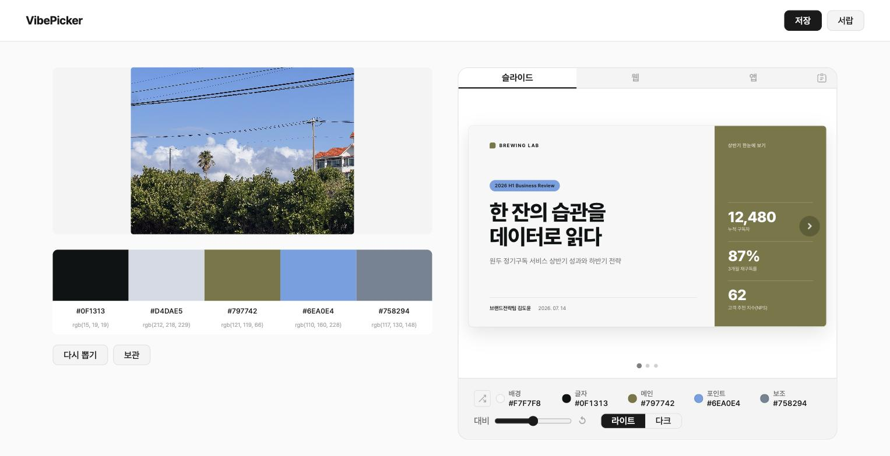
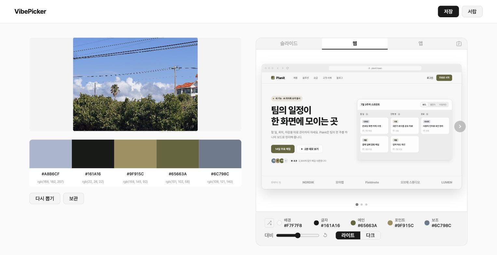
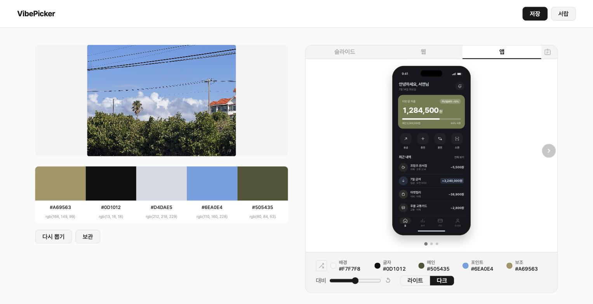

# VibePicker

> 사진 한 장의 분위기(vibe)를 색으로 꺼내, 그 색으로 만든 화면을 바로 보고 AI에게 넘길 프롬프트까지 복사하는 웹앱

**바로 써 보기: https://hwangyerin.github.io/vibe-picker/**



---

## 1. 제작한 것 소개

### 왜 만들었나

**AI가 만든 화면에는 AI 티가 납니다.**
어디서 본 듯한 레이아웃, 비슷비슷한 아이콘과 문구, 그리고 늘 같은 색감까지 AI 티를 만드는 요소는 여러 가지입니다. 이번 프로젝트에서는 그중 **색** 하나에 집중했습니다.

색을 고른 이유는 첫인상을 가장 먼저 정하는 요소이기 때문입니다. 사람은 처음 본 대상을 90초 안에 판단하고 그 판단의 62~90%가 색에서 나오며([Singh, 2006](https://www.researchgate.net/publication/235320162_Impact_of_color_on_marketing)), 웹페이지의 첫인상은 0.05초 만에 정해집니다([Lindgaard 외, 2006](https://www.tandfonline.com/doi/abs/10.1080/01449290500330448)). AI에게 색을 정해주지 않으면 결과물은 매번 비슷한 색으로 나옵니다.

**누구를 위해 만들었나.**
컴퓨터공학과 학생들은 디자이너 없이 개발자끼리 팀 프로젝트를 하는 경우가 종종 있습니다. 서비스 화면부터 발표 자료까지 디자인을 직접 해야 하는데, 색을 어디서 가져올지부터 막막하고, 골라도 어느 색을 배경에 쓰고 어느 색을 글자에 써야 할지 모릅니다. VibePicker는 그럴 때 쓰라고 만들었습니다.

**왜 사진에서 시작하나.**
디자인을 몰라도 사진을 보면 "이 느낌 좋다"는 것은 누구나 압니다. 색 이론을 배우는 대신, 사진에서 느껴지는 그 느낌을 색으로 뽑아내는 것이 VibePicker의 방법입니다. 마음에 드는 사진을 한 장 올리면 됩니다.

### 어떻게 쓰나

1. **사진을 올린다.** 끌어다 놓거나 파일을 고릅니다. 샘플 사진 3장으로 바로 체험할 수도 있습니다.
2. **색 5개가 뽑힌다.** 배경, 글자, 메인, 포인트, 보조 역할이 글자가 잘 읽히는 조합으로 자동 배정됩니다.
3. **실제 화면에서 본다.** 그 색이 입혀진 발표 슬라이드, 웹사이트, 앱 화면을 바로 확인합니다.
4. **프롬프트를 복사한다.** 역할별 색과 사용 규칙이 담긴 프롬프트를 AI에게 그대로 넘깁니다.

### 주요 기능

| 기능 | 설명 |
| --- | --- |
| 색 뽑기 | 사진을 올리면 대표색 5개를 컬러칩(HEX, RGB)으로 보여주고, 클릭하면 복사 |
| 다시 뽑기 · 보관 | 같은 사진에서 다른 5색 조합을 새로 뽑고, 마음에 드는 시안은 5개까지 보관해 비교 |
| 스포이드 · my pick | 사진에서 원하는 곳을 찍어 칩 색을 바꾸고, 고른 칩은 다시 뽑기에도 고정 |
| 예시 화면 | 뽑은 색을 슬라이드 3장, 웹사이트 3화면, 앱 3화면에 입혀 화살표로 넘겨 보기 |
| 랜덤 섞기 · 대비 슬라이더 | 색 역할을 섞어 보고, 읽기 어려운 조합은 경고와 함께 슬라이더로 고치기 |
| 라이트 · 다크 | 팔레트에 어울리는 라이트·다크 배경으로 전환 |
| AI 프롬프트 복사 | 보고 있는 탭(슬라이드·웹·앱)에 맞는 프롬프트를 미리 보고 복사 |
| 서랍 | 마음에 드는 팔레트를 저장하고 다시 불러와 조절 |

올린 사진은 서버로 보내지 않고 브라우저 안에서만 처리합니다.

### 스크린샷

사진에서 뽑은 5색이 발표 슬라이드, 웹사이트, 앱 화면에 바로 입혀집니다.

| 웹사이트 | 앱 (다크) |
| --- | --- |
|  |  |

## 2. PRD와 Todo 리스트

- [PRD.md](./PRD.md) · 무엇을, 누구를 위해, 왜 만드는지. 처음 기획과 달라진 점은 11번에 정리
- [TODO.md](./TODO.md) · 6단계로 나눈 할 일 목록과 작업 중 추가·변경된 것

### 진행 상황

| 단계 | 내용 | 상태 |
| --- | --- | --- |
| 1단계 | 화면 기본 틀 | 완료 |
| 2단계 | 사진 넣고 색 뽑기 | 완료 |
| 3단계 | 예시 화면에 색 입히고 프롬프트로 가져가기 (MVP) | 완료 |
| 4단계 | 조합 가지고 놀기 | 완료 |
| 5단계 | 저장하고 다시 불러오기 | 완료 |
| 6단계 | 완성 기준 점검 | 11개 중 9개 통과, 2개는 직접 확인 필요 |

## 3. 방법론의 장단점

PRD를 먼저 쓰고, 그것을 번호가 붙은 Todo로 쪼갠 뒤, AI에게 단계별로 구현을 맡기는 방식으로 만들었습니다.

### 장점

- **빠르다.** 아주 간단한 프로젝트여서 그런지, Todo에 적은 것을 모두 만들기까지 그리 긴 시간이 걸리지 않았습니다. 덕분에 남은 시간은 UI/UX를 계속 다듬는 데 쓸 수 있었습니다.
- **번호로 대화할 수 있다.** "2-10이 이상해", "4, 8, 7번 순서대로 해줘"처럼 할 일을 번호로 지목하니 지시가 짧고 정확해졌습니다.
- **범위가 지켜진다.** PRD에 "만들지 않는 것"을 적어 두어 기능이 끝없이 늘어나지 않았습니다.
- **검토를 맡길 수 있다.** "객관적으로 필요한 수정사항을 말해줘"라고 물으면 내가 못 본 문제까지 목록으로 받을 수 있었습니다. 역할 배정에서 한 색이 빠지는 문제, 대비 슬라이더를 쓰면 칩과 프롬프트의 HEX가 달라지는 문제가 이렇게 발견됐습니다.

### 단점

- **돌아간다고 완성이 아니다.** 처음 나온 예시 화면은 기능상 문제가 없었지만 너무 단순하고 AI가 만든 티가 났습니다. AI 티를 줄이려는 도구가 AI 티가 나는 셈이어서, 목업 전체를 실제 화면처럼 다시 그려야 했습니다.
- **직접 써 봐야 보이는 오류가 많다.** 다크 모드로 바꿔도 역할 배지의 색이 그대로인 문제처럼, AI가 "완료"라고 한 뒤에 직접 눌러 보다가 찾은 것들이 있었습니다.
- **PRD와 Todo가 계속 바뀐다.** 한 번 쓰고 끝나는 문서가 아니었습니다. 만들면서 결정이 달라질 때마다 PRD와 Todo를 고쳐야 했고, 끝나고 보니 처음 기획과 10군데 가까이 달라져 있었습니다. (PRD 11번)
- **처음 Todo가 작았다.** Todo를 금방 다 끝내고 나니, 그 뒤의 UI/UX 다듬기는 목록 없이 그때그때 떠오르는 대로 진행하게 됐습니다.
- **결정은 결국 사람이 한다.** 무엇이 "실제 화면 같은지", 스크롤이 나은지 화살표가 나은지는 AI가 정해주지 않습니다. 원하는 것을 말로 설명할 수 있어야 결과가 좋아졌습니다.

## 4. 개선이 필요한 점

- **PRD와 Todo를 더 사소한 것까지.** PRD와 Todo에 생각한 것보다 더 사소한 부분까지 적어 두었으면 좋았을 것 같습니다. 적어 두지 않은 세부 사항은 만들면서 하나씩 다시 정해야 했습니다.
- **프롬프트 검증.** 복사한 프롬프트를 실제 AI에 넣었을 때 같은 색 배정의 화면이 나오는지, 디자인 경험이 없는 사람이 설명 없이 쓸 수 있는지는 아직 확인하지 못했습니다. (TODO 6-6, 6-9)
- **색 말고 다른 AI 티.** 이번에는 색만 다뤘습니다. 레이아웃, 폰트, 문구처럼 AI 티를 만드는 다른 요소는 남아 있습니다.
- **비슷한 색이 함께 뽑히는 경우.** 색이 단조로운 사진에서는 5색 중 일부가 거의 같게 나올 수 있습니다.
- **불러온 팔레트의 제약.** 서랍에는 사진을 저장하지 않아서, 불러온 카드에서는 다시 뽑기와 스포이드를 쓸 수 없습니다.
- **모바일.** PC 기준으로 만들었고, 좁은 화면에서는 깨지지 않는 정도의 최소 대응만 했습니다.
- **세부 사용성.** 확인 창이 브라우저 기본 대화상자이고, 보관함 화면 레이아웃(UI-5)은 손보지 못했습니다.

## 5. 결론

VibePicker는 "사진을 올리면 색이 나오고, 그 색이 실제 화면에서 어떻게 보이는지 확인하고, AI에게 넘긴다"는 한 가지 흐름을 끝까지 만든 프로젝트입니다. 디자인을 몰라도 사진에서 느낀 분위기를 색으로 옮길 수 있고, 그 색을 AI에게 정확히 전달할 수 있습니다.

만들면서 느낀 것은 Todo를 다 만드는 데 생각보다 시간이 오래 걸리지 않았다는 점입니다. 그래서 대부분의 시간을 UI/UX를 다듬는 데 썼고, 그 과정에서 PRD와 Todo도 계속 업데이트됐습니다.

다음에는 **Todo를 처음부터 더 구체적으로, 더 잘게 나눠서 구현하고 싶은 것을 최대한 모두 넣어도 되겠다**고 생각합니다. AI와 함께 만들면 구현 속도가 빠르기 때문에, 할 일을 작게 잡기보다 크게 잡아 두는 편이 낫습니다.

---

## 로컬에서 실행하기

자바스크립트를 기능별 모듈로 나눠서, `index.html`을 더블클릭하면 동작하지 않습니다. 로컬 서버로 열어 주세요.

**VS Code**

1. 확장 프로그램 **Live Server**를 설치합니다.
2. `index.html`을 연 상태에서 오른쪽 아래 **Go Live**를 누릅니다.

**터미널**

```bash
python3 -m http.server 8000
```

실행한 뒤 브라우저에서 `http://localhost:8000`을 엽니다.

## 기술 스택

- HTML, CSS, JavaScript (ES 모듈, 외부 라이브러리 없음)
- Canvas API (색 추출), Clipboard API (복사), localStorage (서랍), sessionStorage (새로고침 복원)
- 폰트: Pretendard
- 배포: GitHub Pages
